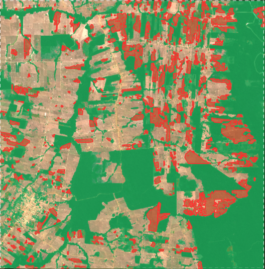
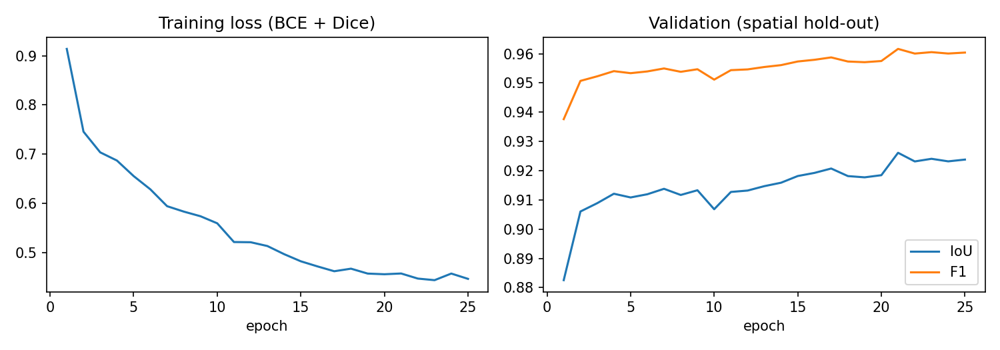

# 🌳 Amazon Deforestation Monitor — Sentinel-2 + U-Net

Automatically detects **where forest has been cleared** in the Brazilian Amazon using free
Sentinel-2 satellite imagery and a U-Net deep learning model, and shows the results on an
interactive web map.



**Study area:** ~20 × 20 km near Jaci-Paraná, Rondônia, Brazil, one of the most heavily
deforested regions in the Amazon. **Period:** 2019 → 2024 (dry season).

**[🗺️ Open the interactive map](https://YOUR-USERNAME.github.io/amazon-deforestation-monitor/)**

---

## 📊 Results

### Forest segmentation (validated on a held-out region the model never saw)

| Model | IoU | F1 | Precision | Recall |
|---|---|---|---|---|
| NDVI threshold baseline (> 0.64) | 0.863 | – | – | – |
| **U-Net (this project)** | **0.926** | **0.962** | **0.975** | **0.949** |

The U-Net improves IoU by **+6.3 points** over the standard vegetation-index method.

### Deforestation detected, 2019 → 2024

| Metric | Value |
|---|---|
| Area analysed | 397 km² |
| Forest cover 2019 | 22,749 ha (57.3%) |
| Forest cover 2024 | 18,026 ha (45.4%) |
| **Forest cleared** | **3,767 ha (16.6% of 2019 forest)** |
| Cleared patches | 487 (largest: 373 ha) |

That is roughly 5,000 football pitches of forest lost in five years.



---

## ⚙️ How it works

```
Sentinel-2 images ──► cloud-free composite ──► U-Net forest map ──► compare years ──► map
   (2019, 2021, 2024)    (median of ~12 scenes)   (pixel-by-pixel)    (forest → cleared)
```

1. **`01_download.py`**: downloads dry-season Sentinel-2 imagery from Microsoft Planetary
   Computer (free, no account), masks clouds and shadows with the scene-classification layer,
   and builds a per-pixel median composite for each year. Also downloads ESA WorldCover 2021
   as training labels.
2. **`02_make_chips.py`**: cuts the 2021 image and labels into 128×128 chips, with a
   **spatial** train/validation split.
3. **`03_train.py`**: trains a U-Net (~0.5M parameters, BCE + Dice loss, flip/rotation
   augmentation) and compares it with an NDVI-threshold baseline.
4. **`04_detect_change.py`**: predicts forest for 2019 and 2024. A pixel counts as *cleared*
   if it was confidently forest before, confidently non-forest after, **and** its NDVI dropped.
   Speckle is removed and patches under 0.5 ha are discarded.
5. **`05_make_map.py`**: builds an interactive Folium/Leaflet map with imagery for both years,
   forest masks and the cleared patches (hover to see hectares).

**Model inputs:** Blue, Green, Red, NIR, SWIR1, SWIR2 + NDVI + NBR (8 channels).

---

## 🧠 Key design decisions

- **No hand-labelling.** Labels come from ESA WorldCover 2021 (class 10 = tree cover), paired
  with a 2021 composite. The trained model is then applied to 2019 and 2024.
- **Spatial validation split.** Neighbouring image chips look almost identical, so a random
  split leaks information and inflates scores. The right-hand 25% of the area is held out
  entirely, and chips that straddle the boundary are dropped.
- **Cloud handling.** The Amazon is cloudy, so instead of one image per year the pipeline
  takes the median of ~12 cloud-masked scenes.
- **Radiometric harmonisation.** Since January 2022, Sentinel-2 L2A values carry a +1000
  offset (processing baseline 04.00). This is removed per scene; otherwise 2024 would look
  systematically different from 2019 and create false "change".
- **Conservative change rule.** Requiring agreement between the model *and* an NDVI drop
  reduces false alarms from cloud residue and seasonal differences.

---

## 🚀 Run it yourself

The area is small enough to run on a laptop CPU or free Google Colab.

**Locally (Python 3.10–3.12):**
```bash
python -m venv .venv
.venv\Scripts\activate            # Windows  (macOS/Linux: source .venv/bin/activate)
pip install torch --index-url https://download.pytorch.org/whl/cpu
pip install -r requirements.txt

python 01_download.py      # ~10–20 min, ~1 GB
python 02_make_chips.py
python 03_train.py         # ~5–15 min on CPU
python 04_detect_change.py
python 05_make_map.py      # -> outputs/deforestation_map.html
```

**Google Colab:** upload the project folder, then run:
```python
!pip install -q rasterio folium pystac-client planetary-computer odc-stac
!python 01_download.py
!python 02_make_chips.py
!python 03_train.py
!python 04_detect_change.py
!python 05_make_map.py
```

To analyse a different area or period, edit `BBOX`, `CRS` (UTM zone) and the years in `config.py`.

---

## 📁 Repository structure

```
├── config.py              # area, dates, model and change-detection settings
├── 01_download.py         # Sentinel-2 composites + WorldCover labels
├── 02_make_chips.py       # training chips with spatial split
├── 03_train.py            # U-Net training + NDVI baseline
├── 04_detect_change.py    # 2019 vs 2024 change detection
├── 05_make_map.py         # interactive map
├── common.py              # U-Net model + tiled prediction
├── raster_utils.py        # raster I/O and spectral indices
├── results/               # metrics, statistics, cleared-area polygons
├── images/                # screenshots for this README
└── docs/index.html        # interactive map (served by GitHub Pages)
```

---

## ⚠️ Limitations and next steps

- Accuracy is measured against WorldCover labels, which have their own errors (~75–80%
  accurate globally), not against hand-checked ground truth.
- Detected clearings have not yet been validated against official alerts (INPE PRODES/DETER
  or Hansen Global Forest Change).
- Next steps: test the trained model on an unseen region (generalisation), add Sentinel-1
  radar for the cloudy wet season, and use monthly composites for near-real-time alerts.

---

## 🛰️ Data and credits

- Sentinel-2 Level-2A, © Copernicus / ESA
- ESA WorldCover 2021, © ESA WorldCover project
- Accessed via [Microsoft Planetary Computer](https://planetarycomputer.microsoft.com/)

**Author:** Sanjeevani Barua
